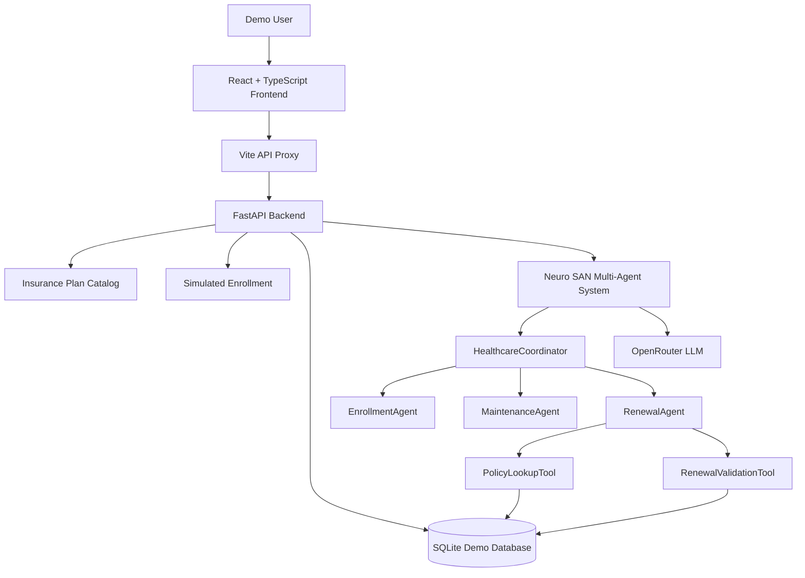

# HealthBridge-AI Architecture

## System Overview

HealthBridge-AI is a fictional US health insurance portal built for a hackathon.

It demonstrates enrollment, policy lookup, renewal eligibility,
and multi-agent AI assistance.

## Architecture Diagram

## Technology Stack
- React, TypeScript, Vite
- Python and FastAPI
- SQLite
- Neuro SAN multi-agent orchestration
- OpenRouter LLM
## Working Features
- Fictional insurance plan comparison
- Simulated enrollment
- Policy lookup
- Renewal eligibility validation
- AI Assistant powered by Neuro SAN
## Demo Safety
This prototype uses synthetic data only. No real insurance
coverage is issued. Policy updates and renewal submissions are
disabled. Authentication is not implemented, so the application
must remain private and must not process real personal data.
